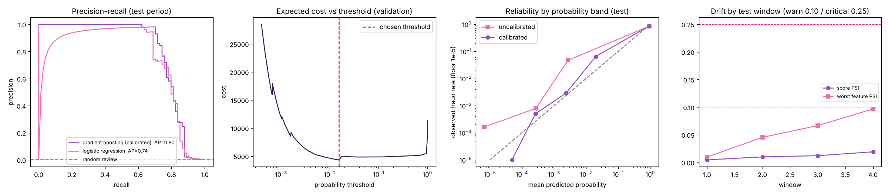

# Cost-Sensitive Card Fraud Detection

Detecting fraudulent card transactions when fraud is extremely rare (0.17% of transactions), evaluated the way a fraud team would care about it: on a **later time period**, with metrics that work for rare events, and with a decision rule chosen by **cost**, not by a default 0.5 cut-off. Includes calibration, uncertainty estimates and drift monitoring across time windows.



## Results (final test period, 74 frauds in 56,746 transactions)

| | Gradient boosting (calibrated) | Logistic regression |
|---|---|---|
| Average precision (PR-AUC) | **0.80** (95% CI 0.73-0.88) | 0.74 |
| ROC AUC | 0.98 | 0.98 |
| Fraud found in the top 0.5% reviewed | **87.8%** (95% CI 80.6-93.8%) | 85.1% |
| Precision in the top 0.5% reviewed | 22.9% | - |

Reviewing 0.5% of transactions at random would find about 0.5% of fraud, so the model finds roughly 175 times more fraud per review than chance.

**Decision rules compared on the test period** (assumed cost: 5 per manual review; a missed fraud costs its transaction amount):

| Rule | Flagged | Frauds caught | Total cost | Saving vs no model |
|---|---|---|---|---|
| No model | 0 | 0 | 7,728 | - |
| Flag everything | 56,746 | 74 | 283,730 | -3,572% |
| Review the top 0.5% by score | 284 | 65 | 3,136 | 59.4% |
| Cost-optimal threshold (tuned on validation) | 122 | 60 | 2,989 | 61.3% |
| Expected-loss rule: flag if probability x amount > review cost | 83 | 24 | 2,857 | 63.0% |

The last rule catches fewer frauds but costs least: many frauds in this data are tiny (median fraud amount 9.25 against a mean of 122), so reviewing them costs more than they save. That is the point of choosing the threshold by cost, and it is a business decision, not just a modelling one.

Other findings
- **Accuracy would be useless here**: always predicting "not fraud" scores 99.8%. Average precision and recall at a fixed review budget are used instead.
- **Logistic regression is close** (AP 0.74 against 0.80). With only 57 frauds in the validation period the two are hard to separate, so the gradient boosting win is real but modest; the intervals above show how uncertain a 74-fraud test set is.
- **Calibration matters**: raw scores from the class-weighted logistic regression are not probabilities (Brier 0.025). Platt scaling fitted on the validation period makes the gradient boosting probabilities usable in the expected-loss rule (reliability plot above).
- **Drift monitoring**: PSI of every input and of the score against the validation period, over four windows of the test period. Score PSI stays below 0.02; the worst input PSI creeps from 0.01 to 0.097 (log-amount, V2) by the last window, just under the 0.10 warning level. Average precision in the last window is 0.57, but it rests on 10 frauds, so treat it as a prompt to watch, not a finding.
- **Most influential inputs** (permutation importance, validation period): V14, V10, V4. The V columns are anonymised PCA components, so this says *which* inputs matter, not *why*.

## Method
1. Remove 1,081 exact duplicate rows (they could land on both sides of a split), then sort by time.
2. **Split by time, never at random**: first 60% train, next 20% validation, last 20% test. The test period is looked at once.
3. Fit logistic regression (class-weighted) and four gradient-boosting configurations on the training period; choose by validation average precision.
4. Calibrate on the validation period, choose the cost-optimal threshold on the validation period.
5. Evaluate the decision rules on the test period with bootstrap confidence intervals.
6. Monitor drift with PSI across later time windows.

## Run it
```
pip install -r requirements.txt
# download creditcard.csv into data/ (see data/README.md)
python run_all.py            # writes outputs/ (results.json, report.png, decision_rules.csv, drift_windows.csv)
python run_all.py --demo     # synthetic stand-in data, no download needed
python -m pytest -q          # 9 tests, run in CI on synthetic data
```

| File | Job |
|---|---|
| `src/data.py` | loading, de-duplication, time-based split, synthetic stand-in data |
| `src/evaluate.py` | average precision, recall/precision at a review budget, cost model, threshold search, bootstrap intervals |
| `src/pipeline.py` | model comparison, calibration, decision rules, permutation importance, drift windows, report |
| `src/drift.py` | Population Stability Index |
| `src/config.py` | split sizes and the business assumptions (review cost, review budget) |

## Limitations (please read)
- The data covers **two days** in 2013 from European cardholders. Real fraud patterns change over weeks and months, so these results say little about long-run performance.
- Only 473 frauds in total (74 in the test period): estimates are noisy, hence the confidence intervals.
- The costs are **assumptions** (5 per review, loss equal to the transaction amount). Real chargeback, reputational and customer-friction costs differ. Change them in `src/config.py`.
- Features are anonymised, so there is no feature engineering on merchant, location or customer history, which is where real systems gain most, and explanations are limited.
- This is an offline analysis, not a deployed system: no serving layer, feedback loop or fairness review.

Data: [Credit Card Fraud Detection](https://www.kaggle.com/datasets/mlg-ulb/creditcardfraud), ULB Machine Learning Group. Not redistributed here; see `data/README.md`.
